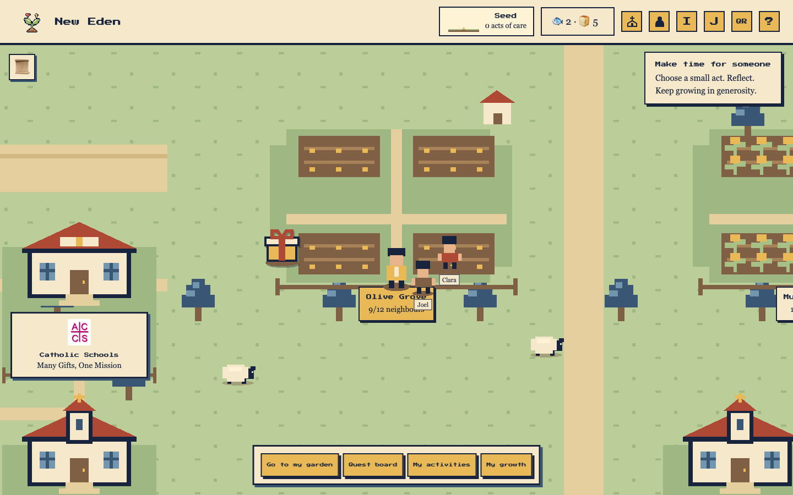
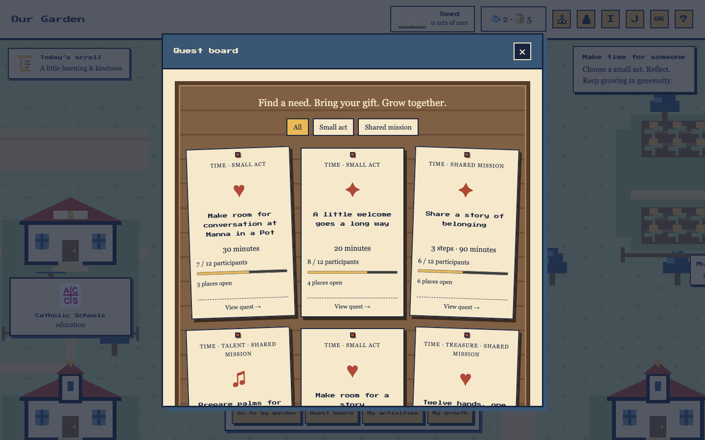
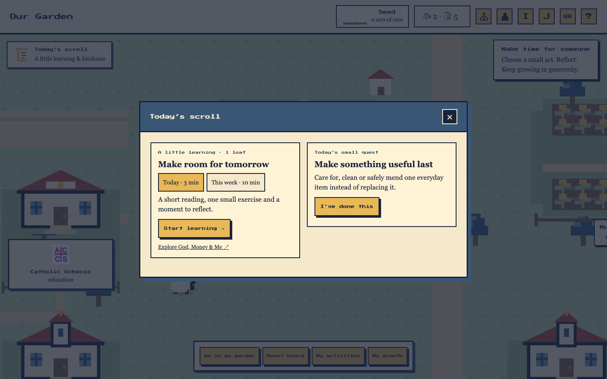
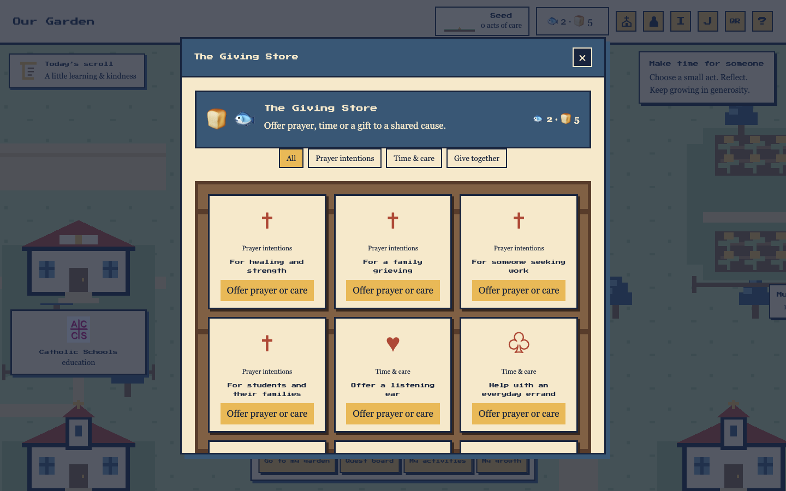
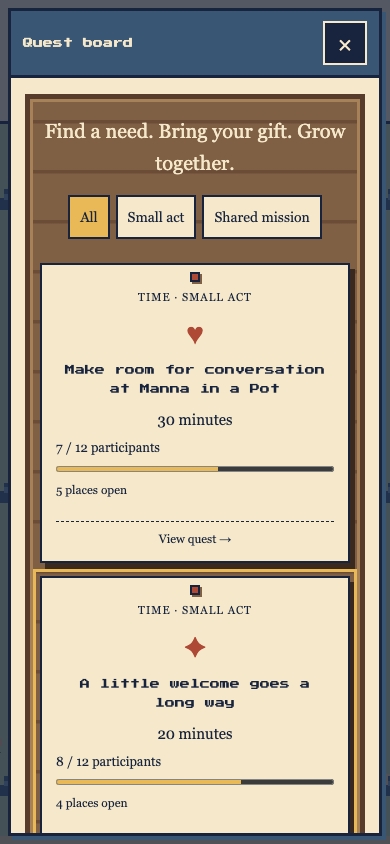

# Our Garden 🌱

**A Catholic stewardship prototype by Army of Angels for FIAT · Catholic Hackathon 2026.**

Our Garden invites people to recognise the gifts they have received, share their time, talents and resources, and grow in community. An explorable pixel garden turns small acts of care into a visible story of participation: receive, share, belong and reflect.

Built for the Catholic FIAT hackathon organised by the Archdiocese of Singapore.

## Team — Army of Angels

- **Patrick A. Tan** — Team leader
- **Coleen**
- **Daphne**
- **Bernard**
- **Jude Lim**
- **Ken Ng**

## Explore the prototype

[Open Our Garden](https://fiat-hackathon-iota.vercel.app)

The experience supports desktop and mobile browsers. On phones, use **Explore map** to reach gardens, organisations and gifts; the world is shown at half scale with touch-friendly navigation. Walk by clicking open ground or using the arrow keys / WASD. Visit garden signs and organisation buildings, explore the quest board, and use **Go to my garden** to return home. The welcome introduction can be replayed using the **I** button or from Help. Open the Giving Store from the wallet, and use the labelled HUD buttons for **Parish team** and **My profile**.

A suggested walkthrough:

1. Enter the garden and meet your fictional parish community at Olive Grove.
2. Explore the quest board and choose a practical act of giving.
3. Accept an activity, select illustrative companions or prepare a friend invitation.
4. Mark the activity complete and see your contribution garden grow.
5. Pause to reflect, explore researched Catholic pathways, or visit the Giving Store.
6. Open **Parish team** to create a quest with a purpose, duration, volunteer capacity, help type and three practical steps; find it on the quest board and try its participation flow.

The hosted version may differ from changes in the local checkout.

## What works

- **Explorable garden:** original pixel scenery, avatar movement, community plots, wandering neighbours and sheep, and organisation stops.
- **Community participation:** join or create a garden with room for up to 12 and choose fictional parish companions. A collapsible meetup form offers the next six weekends and a St Mary’s Mass selection based on a user-supplied schedule; proposals remain local.
- **Gardener profile:** selectable word-cloud buttons for gifts, causes, personal intention and participation capacity. Eight concise cause groups map to the 17 research categories used for recommendations.
- **Today’s scroll:** a map shortcut opens seven rotating original daily learning topics, weekly circle learning and a daily small act. Learning follows reading, exercise and reflection, with one symbolic loaf per dated daily or weekly completion. The scroll disappears after today’s learning and small act are complete; reopening preserves session progress. Content is inspired by God, Money & Me themes and does not certify official course completion.
- **Giving activities:** nine seeded illustrative quests, gift-based recommendations, size filters, daily small-giving invitations, accepted activities and self-reported completion. Participation bars show seeded signup counts plus your own acceptance; full quests prevent new acceptance.
- **Parish quest studio:** create session-only quests with a title, purpose, duration, 1–500 volunteer places, help type and three steps. Full-width fields and inline help-type choices keep the form easy to scan. Published quests support acceptance, completion, garden growth and a Scripture-based reflection.
- **Personal growth:** seed-to-garden participation milestones, contribution flowers, gratitude, optional plans, a journal and reflections.
- **Catholic pathways:** researched organisation and programme cards with official source links, availability caveats and a separate voluntary giving route.
- **Faith and reflection:** Scripture references and labelled paraphrases, guided reflection cards, optional private notes and explicit simulated circle sharing. An illustrative Jesus character can be invited with **J** and stays for 30 seconds.
- **Sharing:** prepared invitation text, clipboard copying, the browser's native share menu where supported, and a QR dialog linking to the hosted app.
- **Giving Store:** 12 options across anonymous example prayer intentions, gifts of time and care, and symbolic shared cause pools. Prayer and care commitments cost nothing, earn no reward and prevent duplicate commitments; item details replace the shelf, with a Back to gifts action.

## Screenshots

Captured from the current local production build using fictional fixture data.

### Desktop garden



### Quest board



### Today’s learning and kindness



### Giving Store



### Mobile quests



## Prototype boundaries

This is a frontend prototype using local fixtures and browser state. There is no backend, account system or shared participant database. Progress, reflections, photos and simulated conversations are temporary and reset when the page reloads; the completed introduction preference is stored locally in the browser.

Participant-facing screens and save confirmations use concise language with fewer prototype reminders. This does not change the temporary storage or connect any live services.

Gardens and neighbours are fictional. Activity completion is self-reported, and photos or notes are not uploaded. Invitation and sharing controls do not automatically send messages, register participants or confirm attendance. Circle reflection sharing updates a local board only; private notes are not shared automatically.

The parish quest studio is an unauthenticated presentation workspace. Created quests disappear on reload. Seeded participant counts are illustrative; accepting adds only the current browser user, and selecting companions does not register them. No live parish publishing, volunteer registration or capacity coordination is connected.

Loaves & Fish are symbolic and have no cash value. Store pools and their milestones are illustrative: no payments or donations are processed. Saving a prayer or care intention does not verify completion or send a message. Participation milestones do not measure spiritual maturity; prayer and private reflections earn no currency.

Research-backed opportunities are distinct from illustrative quests. Consult the linked organiser for current availability and requirements. Parish names and sourced organisation logos do not imply endorsement of this prototype.

## Run locally

Use a current Node.js release supported by the installed Vite version, with npm.

```bash
npm ci
npm run dev
```

Open the URL printed by Vite, normally **http://127.0.0.1:5173**. No environment variables or credentials are required for the local prototype.

Build and preview:

```bash
npm run build
npm run preview
```

The build checks TypeScript and generates `dist/`. Preview normally runs at **http://127.0.0.1:4173**.

Maintainers with the local, ignored `internal/` folder can run the focused reward and research-catalogue checks (these files are not included in a fresh clone):

```bash
node --test internal/tests/*.test.mjs
```

## Stack and project structure

React 19, TypeScript and Vite, with plain CSS and a self-hosted Press Start 2P font.

| Path | Purpose |
| --- | --- |
| `src/` | App components, garden logic and interactions |
| `src/data/` | Curated activity, Scripture and research data |
| `src/ui/` | Shared design tokens and UI primitives |
| `public/` | Static assets, including sourced organisation logos |
| `docs/screenshots/` | README screenshots from the built app |
| `runtime/` | Ignored local screenshots, logs and generated evidence |

## Development

Read [AGENTS.md](AGENTS.md) before making UI changes. Maintainers should also consult their local `internal/design-language.md`, review `internal/research/` before feature changes and maintain `internal/backlog.md`. Internal materials are intentionally excluded from Git. Reuse the existing pixel-sanctuary palette and primitives.

Run `npm run build` after meaningful changes. Check keyboard access, focus, reduced motion and relevant layouts. Mobile styles live in `src/mobile.css`; check portrait and landscape layouts alongside desktop. Physical-device testing remains a follow-up.

The existing production project is hosted on Vercel. App iterations follow the authorised build, deploy and live-verification workflow. `.vercelignore` excludes internal documents and local evidence from deployments; `.gitignore` excludes dependencies, build output, local tool state and credentials. Never put secrets in browser code or `VITE_` variables.

## Next steps

Potential follow-ups include an organiser-approved pilot, persistent community participation, real invitation and RSVP flows, verified organisation publishing, moderation and physical-device validation. These are proposed features, not live services.
